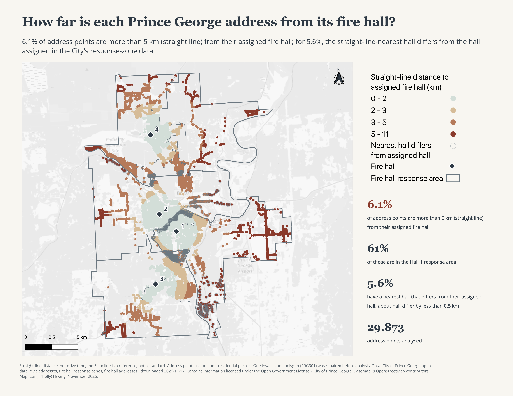

# How far is each Prince George address from its fire hall?

A QGIS analysis of City of Prince George open data: the straight-line distance from every civic address point to the fire hall assigned to it, and where the nearest hall differs from the assigned one.



[Map as PDF](map/pg_fire_hall_map.pdf)

## Key findings

| | Address points | Share |
|---|---:|---:|
| All address points analysed | 29,873 | 100% |
| More than 5 km (straight line) from their **assigned** hall | 1,822 | 6.1% |
| ...of which in the Hall 1 response area | 1,113 | 61% of the 1,822 |
| More than 5 km (straight line) from the **nearest** hall | 1,715 | 5.7% |
| Nearest hall differs from the assigned hall | 1,663 | 5.6% |
| ...of which the difference is under 0.5 km | 823 | 49% of the 1,663 |

By assigned hall ([outputs/summary_by_hall.csv](outputs/summary_by_hall.csv)):

| Assigned hall | Address points | Mean distance (km) | Max (km) | Over 5 km | Nearest hall differs |
|---|---:|---:|---:|---:|---:|
| Hall 1 | 8,665 | 2.46 | 10.85 | 1,113 | 314 |
| Hall 2 | 7,811 | 1.61 | 7.69 | 109 | 536 |
| Hall 3 | 7,119 | 2.35 | 7.05 | 230 | 589 |
| Hall 4 | 6,278 | 2.47 | 10.96 | 370 | 224 |

About half of the "nearest hall differs" addresses are less than 0.5 km further from their assigned hall than from the nearest one, so most of them sit near response-zone boundaries. The zone data does not say how the zones were drawn, so this map shows where the two ways of dividing the city differ, not which one is better.

## Why I made this

I live in Prince George and have been interested in geographic and public-safety data for a while: my final-year statistics project modelled wildfire smoke (PM2.5) in BC, and I am a part-time GIS student at BCIT, where I learned ArcGIS. This was my first project in QGIS. I wanted to practise on real municipal data and answer a question a fire department would care about: how far is each address from the hall that is responsible for it?

## Data

All data is public and was downloaded on 2026-11-17 (details in [data/DATA_README.md](data/DATA_README.md)).

| Data | Source | Notes |
|---|---|---|
| Fire hall response zones | City of Prince George open data | 52 zones; field `station` = Hall 1–4 |
| Civic address points | City of Prince George open data | 29,873 points, one per parcel (includes non-residential parcels) |
| Fire hall locations | Addresses from the City's [Emergency services page](https://princegeorge.ca/node/49); coordinates from the City's civic address points for those addresses | 4 halls; OpenStreetMap positions agree within 19–51 m |
| Basemap | OpenStreetMap | Shown in greyscale |

## Method (QGIS 3.44)

1. **Reproject** all layers to NAD83 / BC Albers (EPSG:3005) so distances are in metres.
2. **Check geometry:** one response-zone polygon (PRG301, Hall 3) was invalid. I repaired it with *Fix geometries* (Structure method); the layer still has 52 zones.
3. **Dissolve** the 52 zones by `station` into 4 hall response areas.
4. **Distance to nearest hub (points):** straight-line distance from each address point to the nearest hall (`HubName`, `HubDist` in km).
5. **Join attributes by location:** attach the assigned hall (`station`) to each address. Every address falls in exactly one zone (0 unmatched).
6. **Field calculator:**
   - `mismatch` = `if(right("station",1) <> right("HubName",1), 1, 0)`
   - `AsgDist` (km to the assigned hall) = `distance($geometry, geometry(get_feature('halls', 'hall_no', to_int(right("station",1))))) / 1000`
7. **Statistics by categories** on `AsgDist` by `station`, then the map layout.

## Checks

- Each fire hall point falls inside a response zone of its own hall.
- Feature counts match the source service (52 zones, 29,873 addresses).
- [checks/independent_check.py](checks/independent_check.py) recomputes the headline numbers without QGIS, using great-circle distance on the raw GeoJSON. The results agree closely with the QGIS output:

  | Measure | QGIS | Independent check |
  |---|---:|---:|
  | Over 5 km from nearest hall | 1,715 | 1,706 |
  | Over 5 km from assigned hall | 1,822 | 1,818 |
  | Nearest hall differs from assigned | 1,663 | 1,668 |

- `HubDist` (from *Distance to nearest hub*) and `AsgDist` (from the `distance()` expression, planar in BC Albers) are measured differently; for addresses whose nearest and assigned hall are the same, they differ by at most 29 m (0.3%).

## Limitations

- Straight-line distance, not drive time. Rivers, bridges and the road network are not considered, so real travel distances are longer.
- Distance relates only to the travel part of response time; alarm handling and turnout are not included.
- The 5 km line is a reference I chose, not a standard.
- Address points are parcels, not people or households, and include commercial and industrial parcels.
- This is a personal analysis, not an official City of Prince George product.

## Next steps

- Road-network distance with QGIS *Service area*, and drive time using the road layer's speed limits and one-way streets, then a comparison with actual travel times from incident data, since emergency travel speeds differ from posted limits.
- Weight addresses by population using Statistics Canada census data.
- Compare with historical incident locations, if available.

## Reproduce

```bash
python3 data/get_data.py              # downloads the City layers into data/
python3 checks/summarize_outputs.py   # headline numbers from outputs/address_check.gpkg
python3 checks/independent_check.py   # independent re-check without QGIS
```

Then open `pg_fire.qgz` in QGIS 3.44 or later; it loads the layers from `outputs/` and contains the print layout used for the map.

## Repository contents

| Path | Contents |
|---|---|
| `map/` | Final map (PNG, 300 dpi, and PDF) |
| `pg_fire.qgz` | QGIS project with styles and print layout |
| `outputs/` | Analysis outputs: hall points, repaired zones, hall response areas, address points with distances, summary table |
| `data/` | Download script, data notes, fire hall CSV, response zones (the large address and road files are downloaded by the script) |
| `checks/` | Summary and independent re-check scripts |

## Licence and attribution

Contains information licensed under the [Open Government License – City of Prince George](https://pgmapinfo.princegeorge.ca/opendata/CityofPrinceGeorge_Open_Government_License_Open_Data.pdf). Basemap © OpenStreetMap contributors. Code in this repository is released under the MIT License.

Eun Ji (Holly) Hwang, November 2026
